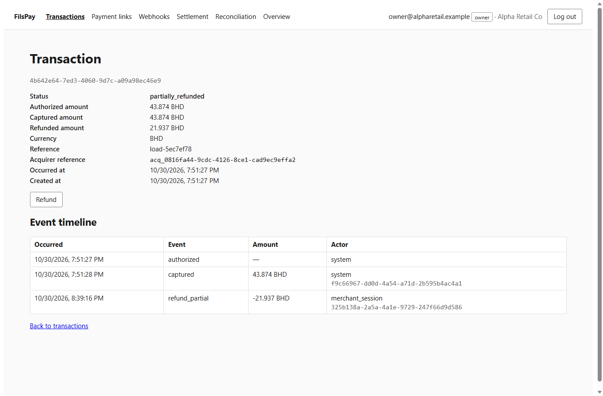
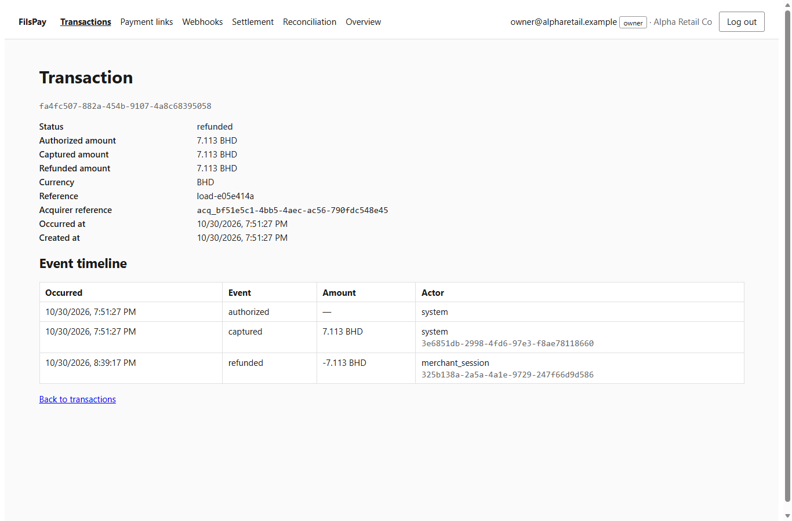
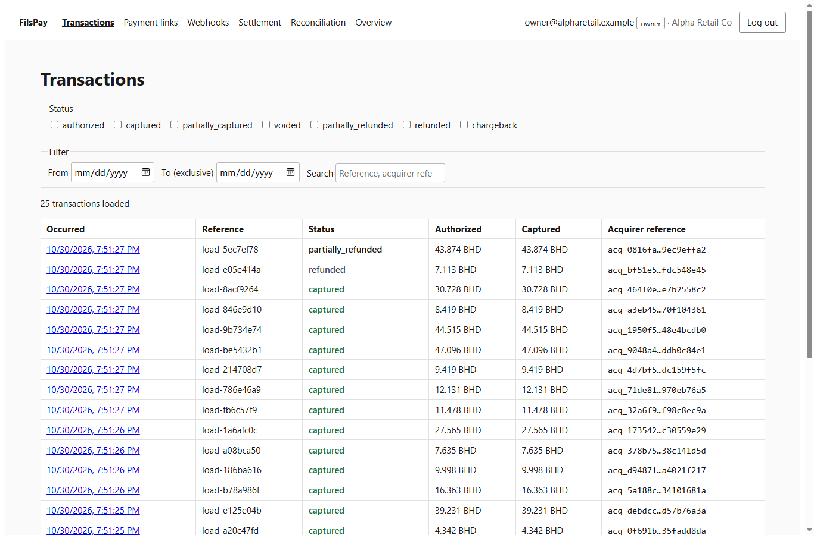
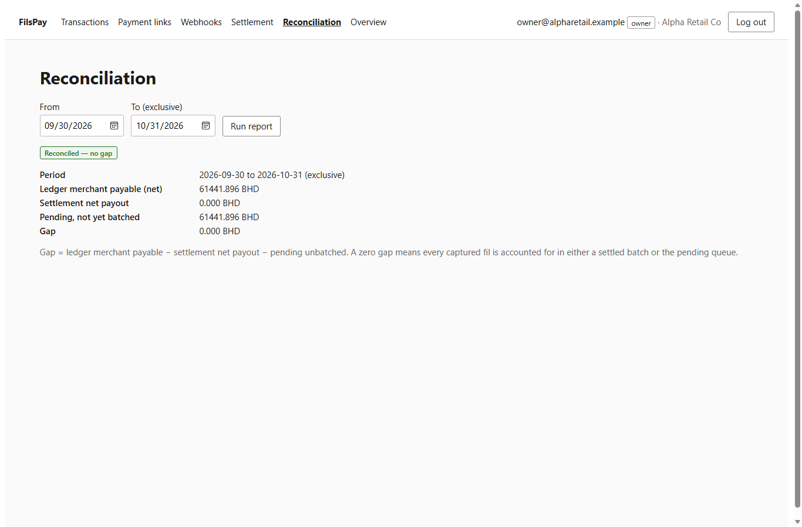
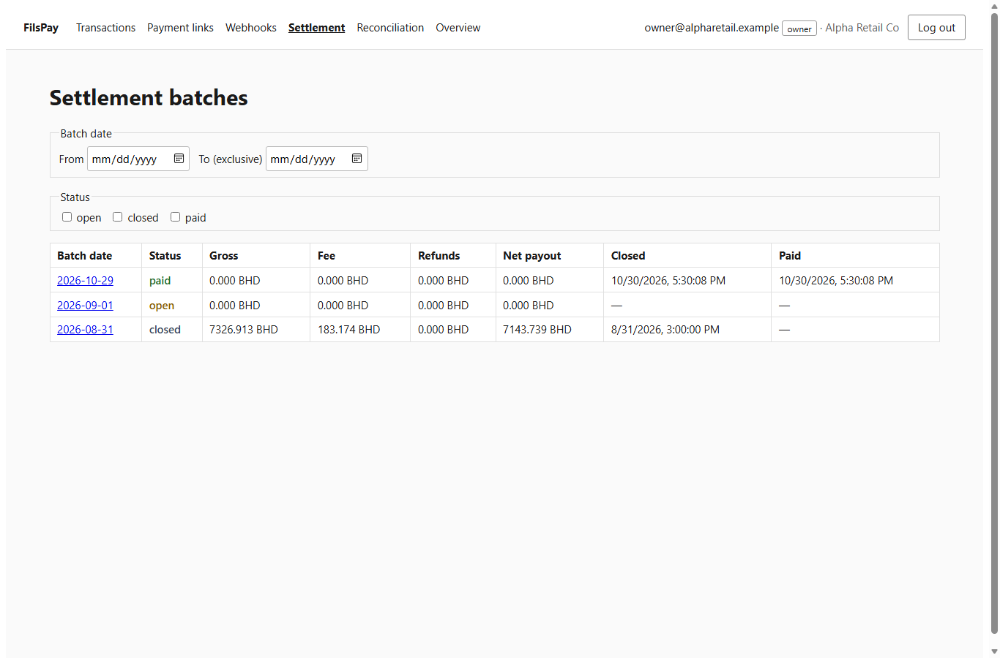
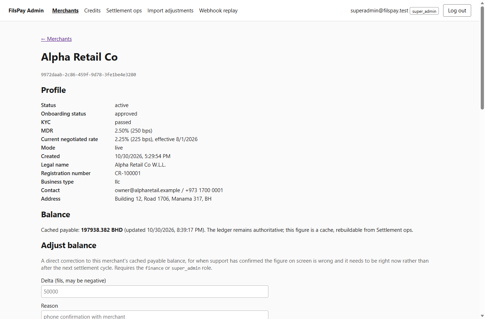
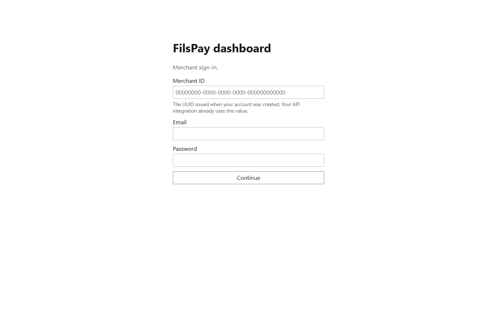
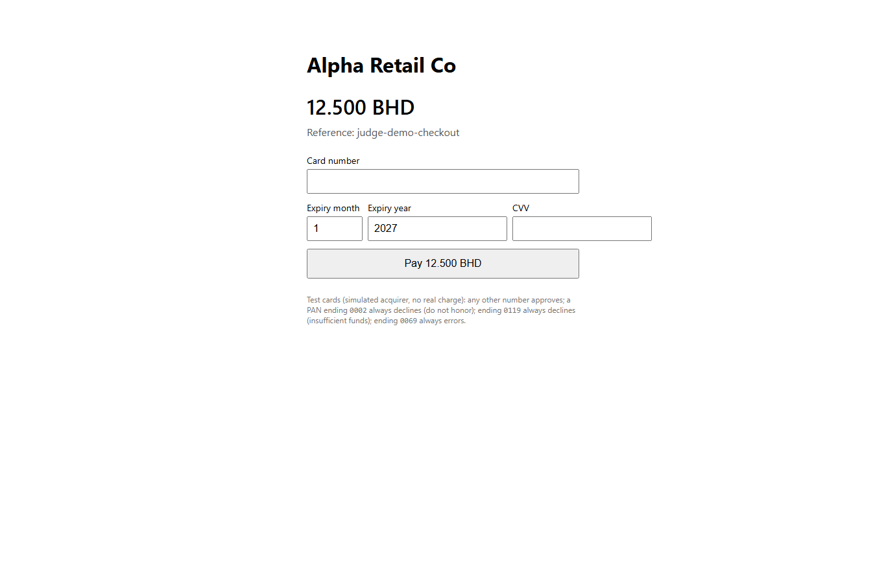

# CyberStar — FilsPay FP-300 Submission

| Cover | |
|---|---|
| **Team** | CyberStar |
| **Members** | Dana Alhayki and Aljazi Almujaddam — worked together on every phase: audit, fixes, refunds, deployment, load testing and the write-up |
| **Repository (public fork)** | https://github.com/Danaalhayki/fils-pay (fork of `MJ5-byte/fils-pay`) |
| **Last commit before the deadline** | `[commit id from GitHub]` |

**Live URLs** (Dilmune Cloud VM, HTTPS with a Let's Encrypt certificate)

| What | URL |
|---|---|
| Checkout | https://157-245-99-130.sslip.io/pay/plink_nIFfk8f_0WcfUkx-unpM0A (12.500 BD, test card `4242 4242 4242 4242`; a link can be paid once — create more under Payment links in the dashboard) |
| Merchant dashboard | https://157-245-99-130.sslip.io/dashboard |
| Admin console | https://157-245-99-130.sslip.io:8443 |
| Public API | https://157-245-99-130.sslip.io/v1/ (health: `/healthz`, `/readyz`) |

Demo logins (seeded demo data; `OTP_DEV_EXPOSE=true` shows the one-time code on the login page because there is no email/SMS provider):

- Merchant: `owner@alpharetail.example` / `FilsPaySeed!2026` (merchant ID `9972daab-2c86-459f-9d78-3fe1be4e3280`)
- Admin: `superadmin@filspay.test`, `finance@filspay.test`, `support@filspay.test` / `FilsPayAdminSeed!2026`

<div class="pagebreak"></div>

## 1. Summary

**What we found.** 153 numbered findings plus 25 smaller items (Lows and
doc mismatches): 15 Critical, 64 High, 59 Medium, 15 Low. They cover
authentication (login without the OTP, cross-merchant IDORs, impersonation
with owner powers, unsigned acquirer callbacks), money (a 10× CSV import
error, the daily close running at 03:00 instead of midnight, a payment
link charging two cards, float and int32 money, a balance rebuild that
wiped balances, paid batches rewritten), refunds (the feature was a 501 stub
with eight bugs in the half-built code), webhooks, the reporting consumer,
ops, and — after load testing — capacity. Full list: `BUGS.md` (Appendix A).

**What we fixed.** Every numbered finding is fixed in code or docs, each
with the smallest change and, for the non-trivial ones, a new test that fails
before and passes after. Refunds are finished end to end (`POST /v1/refunds`,
dashboard drawer, ledger and fee reversal, settlement netting, reporting,
`refund.succeeded` webhook). The stack runs from one `docker compose`
command on a 1 vCPU / 2 GB VM with the API held to 0.5 vCPU / 512 MB, sheds
load with 503s, restarts itself when hung and serves HTTPS.

**What we left alone.** The two frozen money packages (no defects found
there that needed changing); restructuring authorize/capture so the database
transaction is not held across the acquirer call (documented capacity limit);
whether manual credits should be paid out by the daily close (needs a finance
decision); rotating the acquirer secret that was committed to git (needs the
acquirer). Two reported items turned out not to be bugs (S-30, M-20).

**Main root cause.** The documents the team relied on disagreed with the
rules, and nobody checked one against the other. The AI rule files said
"1 BD = 100 cents", "UTC midnight" and "`Math.random` is fine"; the handover
and postmortem marked fixes "done" that were never merged; code comments
asserted locks and constraints that did not exist. Most of the money and
security bugs are those statements turned into code. The second root cause
is **invariants enforced in one path but not the others** (scope checks in
middleware but not in the query, idempotency on one route but not its
sibling, a cache with two definitions, two fee formulas).

<div class="pagebreak"></div>

## 2. Architecture and deployment

```
                          Internet
                             │  only 22 (SSH), 80, 443, 8443 open in the firewall
                  ┌──────────▼───────────┐
                  │ caddy  (TLS)         │ Let's Encrypt for 157-245-99-130.sslip.io
                  │ :80 :443 :8443       │ 443 → web:8080, 8443 → web:8081
                  └─────┬──────────┬─────┘
                  :8080 │          │ :8081          (Docker network only)
                  ┌─────▼──────────▼─────┐
                  │ web  (nginx)         │ merchant SPA, /pay checkout | admin SPA
                  │                      │ /v1, /healthz, /readyz → api (re-resolved)
                  └──────────┬───────────┘
                             │ :3000   (host: 127.0.0.1 only)
                  ┌──────────▼───────────┐   :8091 internal   ┌────────────────────┐
                  │ api  (Fastify, Node) │───────────────────▶│ settlement  (Go)   │
                  │ 0.5 vCPU, 512 MB     │   bearer token     │ daemon: daily close │
                  │ load shedding, wdog  │                    │ 00:15 Bahrain       │
                  └──────────┬───────────┘                    └─────────┬──────────┘
                             │ :5432   (host: 127.0.0.1 only)           │
                  ┌──────────▼──────────────────────────────────────────▼──┐
                  │ postgres 16          volume: filspay_pgdata            │◀── reporting
                  └────────────────────────────────────────────────────────┘    (outbox consumer,
     one-off: migrate (runs before every start) · seed (opt-in profile, refuses production)   no port)
```

Only Caddy is reachable from the internet. The API and Postgres are
published on the host's loopback interface only (for SSH debugging);
settlement and reporting have no published port at all.

**Redeploy (one command, on the VM):**

```
cd ~/filspay && git pull && cd ops && docker compose --profile https up -d --build
```

The whole stack is `ops/docker-compose.yml` (infrastructure as code); fresh
install steps are in `ops/DEPLOY.md`. `migrate` runs and must exit 0 before
any service starts; it applies only migrations not yet recorded.

**Secrets.** An untracked `ops/.env` on the VM (git ignores `.env*` except
`.env.example`), generated with `openssl rand`: Postgres password, the
API↔settlement bearer token, the webhook-secret encryption key and the
acquirer callback secret. With `NODE_ENV=production` the API refuses to boot
with a missing secret or a development default (S-37, O-06). The sandbox
acquirer secret that used to be committed (S-15) is removed from the tree
but is still in history; it must be rotated by the acquirer.

**Health checks and restart policy.**

| Service | Health check | On failure |
|---|---|---|
| postgres | `pg_isready` every 2 s | dependants wait; `restart: unless-stopped` |
| api | `/healthz` every 10 s (never touches the DB, never shed) | after 3 consecutive failures the check kills node; tini exits; Docker restarts it (~40 s). Docker alone never restarts a *hung* container. |
| web | starts only when api is healthy | nginx re-resolves `api` so it follows a restarted container |
| all | `restart: unless-stopped` | come back after a crash or a VM reboot |

**How a redeploy avoids interrupting a settlement run.**

1. `up -d --build` only recreates services whose image or config changed; an
   app-only change leaves the settlement container running.
2. The daemon closes the business day once, at 00:15 Asia/Bahrain. Deploys
   are done outside 00:00–01:00 Bahrain.
3. If settlement is recreated mid-run, SIGTERM cancels the daemon's context:
   the in-flight per-merchant batch transaction commits or rolls back, the
   internal API waits up to 30 s, and compose allows 60 s
   (`stop_grace_period`, C-09) before a hard kill.
4. Even a hard kill is safe: every batch operation is one Postgres
   transaction, close and payout are idempotent, and the daemon re-attempts
   the most recent business day on start (a missed older day is re-run with
   `settlement run-batch --date=…`). A failure for one merchant no longer
   stops the run for the others (O-10).

<div class="pagebreak"></div>

## 3. Capacity

**Scenario and tool.** `scripts/loadtest/checkout.ts` (TypeScript, Node
fetch). Closed-loop virtual users each repeat one checkout: the merchant
creates a payment link → the buyer opens `/pay/:token` → reads the link →
pays with the test card and an `Idempotency-Key`. Every 20th checkout fires
two concurrent pays at the same link to probe for double charges. At the end
it re-reads every paid link. A 503 is retried after `Retry-After` with the
same key.

**Live results** (from Bahrain over the internet to the Dilmune VM, 30 s
stages, commit `4fbd4b6`; latency = page + read + pay as the buyer sees it):

| VUs | checkouts/s | p50 | p95 | p99 | 503 shed | 5xx | double charges |
|----:|------------:|----:|----:|----:|---------:|----:|---------------:|
| 5   | 3.8  | 1.10 s | 1.43 s | 1.67 s | 0 | 0 | 0 / 5 probes |
| 10  | 8.0  | 1.05 s | 1.31 s | 1.45 s | 0 | 0 | 0 / 12 |
| 20  | 13.4 | 1.18 s | 1.84 s | 3.21 s | 0 | 0 | 0 / 20 |
| 50  | 19.1 | 2.12 s | 2.84 s | 3.17 s | 0 | 0 | 0 / 29 |
| 100 | 18.3 | 4.13 s | 6.70 s | 7.42 s | 54 | 0 | 0 / 9 |
| 150 | 23.1 | 4.44 s | 11.39 s | 11.81 s | 345 | 0 | 0 / 12 |

(100 and 150 VUs ran 10 s stages.) Across 1,743 checkouts: zero 5xx, zero
double charges, every re-read paid link still `paid`. The other pay
responses are designed outcomes: `402` declines and `502 acquirer_unavailable`
are the simulator's 2 % failure rate per acquirer call (3.8 % measured over
authorize + capture), and every `409` is the refused second pay of a probe.

**Estimate.** About **20 concurrent buyers mid-payment at ~13 checkouts/s
with p95 under 2 s** (≈ 48,000 checkouts an hour), up to **~50 at ~19/s
with p95 under 3 s**. Past that, throughput holds at ~20/s and the excess is
turned away with 503s instead of slowing everyone down. Real buyers pause
between steps, so this is several hundred buyers on the site at once.

**Bottleneck.** Measured locally with the same limits: each pay holds a
pool connection and the merchant's balance row for the 100–400 ms simulated
acquirer call; after we removed two full-table scans from the capture path
(C-06, migration 0086 — 316 M ledger rows had been read in one test) the
API's 0.5 vCPU is saturated at ~30 checkouts/s. On the live VM the single
vCPU is shared with Postgres, settlement, reporting, nginx and Caddy, which
is why the ceiling is ~20/s. Next step: give the API more CPU, then move the
acquirer call out of the database transaction.

**Turning away excess load.** `apps/api/src/plugins/overload.ts` answers
`503` + `Retry-After: 1` before doing any work when requests in flight
(256), requests waiting for a DB connection (64) or event-loop delay (500 ms)
pass their limit. A DB pool timeout is a 503 too, not a 500. Health checks
are never shed. Paying is idempotent, so the client's retry is safe.

**Recovery without data loss.** Memory is capped so V8 exits before the
kernel OOM-kills it mid-request; a hung process is killed by the
health-check watchdog and restarted (measured: ~39 s to restart, healthy
through nginx ~13 s later); nginx follows the new container without a
reload. Money moves only inside committed transactions, an interrupted pay
is replayed with the same `Idempotency-Key`, and data lives in a named
volume. Details: `ops/CAPACITY.md`.

<div class="pagebreak"></div>

## 4. Findings report

### 4.1 How we found and verified findings

- **Rules first.** We read the brief and the nine ADRs, then checked every
  path that handles money, auth, time or settlement against them. Docs,
  postmortems, the handover and code comments were treated as claims to
  verify (several "done" items were false: D-04).
- **Reproduction.** Each finding was reproduced before fixing: a failing
  test against the real Postgres (most findings), a query against the
  seeded database (e.g. M-05 135K → 7K, M-02 scheme totals, M-24 cache
  drift), an HTTP call against the running stack (IDORs, OTP bypass,
  unsigned callbacks), or a load test (C-01 … C-09).
- **Verification.** New tests in `*.new.test.ts` / `*_test.go` (listed in
  `BUGS.md` "Tests added"). Existing tests that encoded a bug were corrected
  and each one is listed with the reason ("Tests changed"). Final run:
  `npm test` 495 tests (events 4, money 40, api 421, reporting 14, web 9,
  scripts 7) and the Go settlement suite — all passing on a freshly migrated
  database.
- **Passes.** Four audit passes (payments, auth/admin, settlement in Go,
  webhooks/reporting/ops), then a capacity pass under load.

Every finding has its own entry in **Appendix A (`BUGS.md`)** with
*where*, *what* (symptom), *why* (root cause), *impact* and *fix*, plus the
test that proves it.

### 4.2 Highest-impact findings

| ID | Severity | Symptom | Root cause | Fix · proof |
|---|---|---|---|---|
| S-01 | Critical | Login works without the OTP | session lookup moved to a view that dropped `authenticated = true` | predicate restored · auth tests |
| S-07, S-08 | Critical | Merchant A cancels B's link / refunds B's transaction | ID-only `UPDATE`/`SELECT`, scope checked on the path only | scope in the query · `refunds.new.test.ts` IDOR cases |
| S-12 | Critical | Unsigned or replayed acquirer callbacks accepted | signature optional, HMAC over re-serialised JSON, no timestamp window | raw-body HMAC, `timingSafeEqual`, 5-min window |
| M-08 | Critical | CSV import posts 4.75 BD as 0.475 | 2-decimal "cents" parser (the trap rule) | `parseBhdToFils` · test corrected 475 → 4750 |
| M-11 | Critical | One payment link charges two cards | 60 s self-expiring reservation, no fencing token | `reservation_id` fence (0083); loser voided/refunded · `payReservationFence.new.test.ts` |
| M-01 | Critical | Daily close at 03:00 Bahrain | "today" computed from the UTC date | Bahrain zone · `daemon_due_test.go` |
| A-01 | Critical | Night job deletes every hold when nothing expired | empty filter list built `DELETE FROM holds` | one `UPDATE … status='expired'`, empty list → `false` · `expire_holds.test.ts` |
| A-03 | Critical | March reconciliation posts again on every run, "dry run" included | random group id per run, no existence check | deterministic group id, advisory lock, real `--dry-run` |
| R-02 | Critical | Refund more than was captured | refundable computed from the authorized amount | `captured − refunded` · `refunds.new.test.ts` |
| R-03 | Critical | Two concurrent refunds both succeed | validated in one transaction, journaled in another, no row lock | one locked transaction · concurrent-refund test |
| M-05 | High | "Rebuild balances" turns 135K into 7K | rebuilt from scheme export lines, not the ledger | ledger walk (ADR-0007) |
| M-06 | High | MDR recalculation rewrites paid batches | `status <> 'open'` includes `paid` | closed batches only · `recalculate_mdr_paid_test.go` |

### 4.3 Effect on existing data

| Change | Effect on existing rows |
|---|---|
| 0073 callback dedupe | duplicate acquirer callback notes deleted, unique index added; ledger untouched |
| 0074, 0080 | ledger and admin audit log made append-only by trigger; no rows changed |
| 0075 | adjustment imports get a content hash; existing rows keep NULL |
| 0076 | refund columns and netting added; existing batches unchanged |
| 0077 | duplicate payout disbursements **moved** to `settlement_payout_disbursements_duplicates` for finance review, then a unique index |
| 0078, 0082, 0086 | reporting commit-order tracking and indexes only |
| 0079 | lifetime payout estimate: `REAL` → `BIGINT`, recomputed from paid batches |
| 0081 | balance cache rebuilt from the ledger for every merchant and maintained by trigger (ADR-0008) — dashboards show the ledger figure from now on |
| 0083, 0084, 0085 | new columns (reservation fence, pending audit outcome, endpoint soft delete); no data rewritten |
| Paid history | never rewritten: MDR recalculation is limited to closed batches; corrections are reversing entries |

### 4.4 Root causes

1. **Untrusted documents treated as specification** (D-01 … D-08, M-08,
   M-01, S-04, M-14 … M-16, R-01, M-21). The AI rule files, handover,
   postmortem and comments contradicted the ADRs. *Decision:* the ADRs are the
   rules; we rewrote the rule files to match them (`AGENTS.md`) and corrected
   the docs.
2. **Authorization in one layer only** (S-07 … S-10, S-16, S-21, S-22,
   S-24, S-32, S-38). Middleware checked the path, the SQL did not scope by
   merchant. *Decision:* every handler checks role and merchant scope, and
   every query carries `merchant_id`.
3. **Check-then-act without a lock or constraint** (S-03, S-19, R-03, M-11,
   M-13, M-32, W-01, W-09, O-05). *Decision:* atomic `UPDATE … RETURNING`,
   row locks, unique indexes, fencing tokens and advisory locks.
4. **Two implementations of one rule** (M-17, M-19, M-22, M-24, M-41, M-39,
   M-23). Fees, discounts and the balance cache were computed differently in
   the API and in Go. *Decision:* one formula (settlement's), one cache
   definition maintained by trigger.
5. **Wrong numeric types and clocks** (M-14, M-15, M-16, M-01, M-18, M-29,
   A-04). *Decision:* integer fils in `BIGINT`/`int64`; Bahrain dates
   everywhere; server clock only.
6. **No operational limits** (C-01 … C-09, O-02, O-08). *Decision:*
   resource limits, load shedding, a watchdog, re-resolving proxy, indexes on
   the payment hot path.

### 4.5 Decisions and open risks

| Item | Decision | Why | Safeguard / next step |
|---|---|---|---|
| Acquirer call inside the DB transaction | not changed | changes the payment state machine and crash recovery | pool sizing, shedding; proposed two-phase claim → call → complete |
| Manual credits never paid out by the close | not changed | no doc says which is intended | finance decision; design note in `docs/design/settlement-v2.md` |
| Leaked acquirer sandbox secret (S-15) | removed from tree, `.env*` ignored | still in git history | rotate with the acquirer |
| Demo OTP exposure | `OTP_DEV_EXPOSE=true` on the demo | no email/SMS provider exists | never set with real merchants; production default is off |
| Frozen money packages | not edited | finance sign-off | none needed: defects were in callers |
| Seed on the live demo | run once with `NODE_ENV=development` | demo data for judging | seed refuses production and non-local DBs (A-02) |
| S-30, M-20 | not changed | S-30 is not a bug (KYC is enforced); M-20 matches ADMIN.md | evidence in `BUGS.md` |

<div class="pagebreak"></div>

## 5. UI and UX changes

_"After" screenshots were taken from the live site on 30 Oct 2026 after a
partial refund (21.937 of 43.874 BD) and a full refund (7.113 BD) made
through the dashboard API. "Before" describes the original code (challenge
commit `8b58b0f`); the matching `BUGS.md` entry explains the cause._

**5.1 Refunds work, with the refunded amount and negative amounts shown
(R-01, R-12, R-13, M-26).**
*Before:* the refund drawer posted to `/v1/merchants/:id/refunds`, which
did not exist (and `/v1/refunds` answered 501), so no refund was possible; a
double click would have sent a second refund with a new idempotency key; the
transaction had no refunded amount; and `bhd()` threw on a negative number,
so the first refund line in a timeline blanked the whole dashboard.
*After:* status `partially_refunded`, "Refunded amount 21.937 BHD", the
refund line shown as −21.937 BHD, and the Refund button still offered for the
remaining 21.937 BHD.



**5.2 Full refund and refund statuses in the transaction list (R-09).**
*Before:* a full refund of a partial capture was labelled
`partially_captured`. *After:* `refunded` and `partially_refunded` are
filterable statuses and show in the list.





**5.3 Reconciliation ties out (M-23, M-27).**
*Before:* every paid batch appeared as a large negative gap ("not
reconciled") on the default 30-day window, and pending amounts ignored
refunds. *After:* "Reconciled — no gap" with the refunds included.



**5.4 Settlement batches show refunds (R-06).**
*Before:* the close ignored refunds and paid the merchant the full gross.
*After:* each batch has a Refunds column and nets them into the payout.



**5.5 The rate shown is the rate charged: 225 bps (M-07).**
*Before:* the screen showed 245 bps (the most recently *inserted* fee row, a
backfill) while payments were charged 225 bps. *After:* the effective-dated
rate, "2.25 % (225 bps), effective 8/1/2026".



**5.6 The site root opens the sign-in page (router fix).**
*Before:* `https://…/` showed "Unexpected Application Error! 404 Not
Found". *After:* `/` and unknown paths redirect to the dashboard (sign-in
when logged out).



**5.7 Checkout.** Same page, but the server now judges expiry on its own
clock (M-12) and a link can only be paid once (M-11).



<div class="pagebreak"></div>

## 6. AI usage

### 6.1 Setup (in the repository)

| What | Where | Purpose |
|---|---|---|
| Agent instructions | `AGENTS.md` (+ `CLAUDE.md`, `.cursorrules` pointing to it) | rewritten from the trap versions to match the ADRs (D-01) |
| Scoped rules | `.cursor/rules/money-and-time.mdc`, `frozen-money.mdc`, `migrations.mdc`, `audit-findings.mdc` | money units and Bahrain dates on code that touches them; no edits to frozen packages; safe migrations; how to record a finding |
| Custom commands | `.cursor/skills/verify`, `record-finding`, `loadtest` (run as `/verify`, `/record-finding`, `/loadtest`) | the repeatable steps of the audit |
| Permission rules | `.cursor/cli.json` | allow tests and read-only Docker/git; deny push, reset, volume prune, seed, reading `.env`, writing frozen money packages and ADRs |
| Helper scripts | `scripts/ai/verify.ps1`, `scripts/ai/verify.sh`, `scripts/loadtest/checkout.ts` | sequential verification (both suites share one DB); load test |

Tool: Cursor agent with parallel sub-agents for the audit passes, a
terminal against the local Postgres and Docker stack, and an SSH session to
the VM for deployment.

### 6.2 Excerpt 1 — the AI caught the trap rules and the 10× import bug (M-08, D-01)

**Prompt (Dana):** "i am on a new challenge, where it is to find bugs on
existing code… read @FP-300.pdf, read the instructions and understand them
well." Context: the brief PDF and the whole repository, including the trap
`.cursorrules` / `CLAUDE.md` / `AGENTS.md` that the agent loads automatically.

**AI (excerpt):** "The repo has three AI instruction files… Several of their
rules contradict the brief and the ADRs, and following them would hide
exactly the bugs we're looking for… **Money unit:** they say 1 BD = 100
'cents'. The brief and ADR-0001 say 1 BD = 1000 fils. That mismatch alone
would explain the 10× CSV import bug."

**How we verified:** traced the import to `parseDecimalMinor(raw)` with a
default of 2 decimals; `"4.75"` produced `475` fils. The existing test
`adjustmentImport.test.ts` asserted `475`, i.e. it locked the bug in.

**What we changed:** the parser uses `parseBhdToFils`; the test was
corrected to `4750` and recorded in `BUGS.md` "Tests changed". The rule files
were rewritten so the next agent gets the real rules.

### 6.3 Excerpt 2 — the AI was wrong: "KYC is never checked" (S-30 → S-32)

**Prompt:** asked to fix the remaining open findings. Context: `BUGS.md`,
the code, the seeded database.

**AI, first (wrong):** listed among open bugs: "KYC approval is never
checked (S-30)", reasoning that capture and settlement never read
`kyc_passed`.

**How we noticed:** before changing code the agent had to reproduce it.
Querying the seeded DB, the only merchants with `approved` status and
`kyc_passed = false` were test fixtures; the app sets `approved` only
together with `kyc_passed = true`, and authorize refuses non-approved
merchants. AI: "S-30 is a false positive since all payments are KYC-gated."

**What it showed and what we changed:** the real gap was next to it —
"a suspended merchant currently isn't actually blocked anywhere — sessions,
API keys, and authorize all still work". S-30 is recorded as *not a bug*
with the evidence; the real bug became S-32 (suspended/closed merchants
refused at session, API-key and authorize level, with tests).

### 6.4 Excerpt 3 — the AI was wrong about the bottleneck (C-06)

**Prompt:** capacity work: "reject overload with 503 … load-test script and
a measured estimate". Context: the local Docker stack with the brief's
limits, `pg_stat_activity`, `pg_stat_user_tables`, `docker stats`.

**AI, first (wrong):** "The bottleneck is the database connection queue,
not CPU — each payment holds a connection for ~0.5 s while waiting on the
acquirer… I'll bump `PG_POOL_MAX` to 40."

**How we verified:** re-ran the load test with a 40-connection pool:
"Pool size 40 didn't help either — throughput actually dropped and latency
got worse." The agent then sampled `pg_stat_user_tables`: "316 M rows read
from `ledger_entries` and 18 M from `holds`" — the deferred ledger balance
check and the holds lookup had no index and scanned whole tables while the
merchant's balance row was locked.

**What we changed:** pool back to 20; migration 0086 adds the two indexes
(seq scans gone); measured the API at ~90 % of its 0.5 vCPU quota, which is
the real limit; added load shedding so the excess gets a fast 503. Recorded
as C-01 and C-06.

<div class="pagebreak"></div>

## Appendix

- **A. Full findings (`BUGS.md`)** — follows this page.
- **B. Capacity method and raw numbers** — `ops/CAPACITY.md`.
- **C. Deployment** — `ops/DEPLOY.md`, `ops/docker-compose.yml`.
